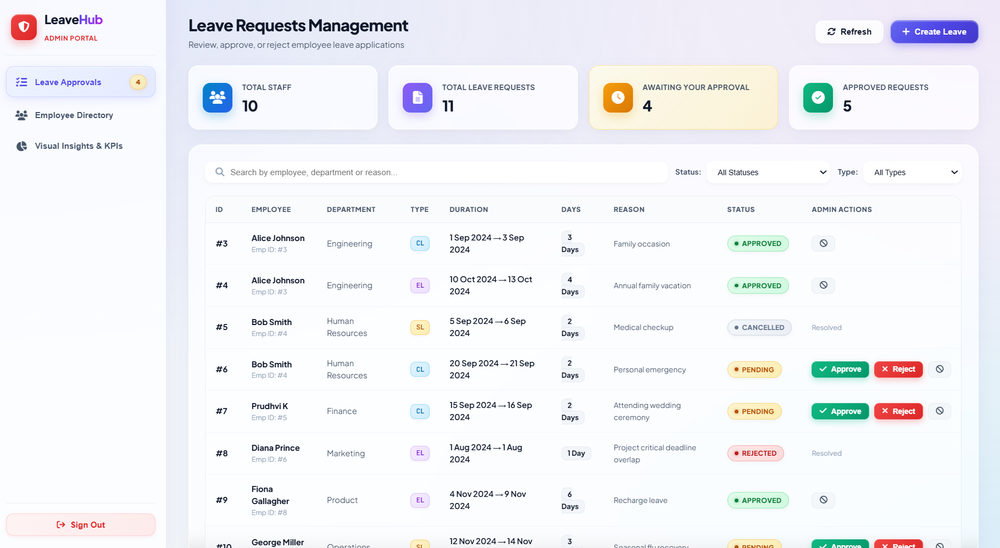
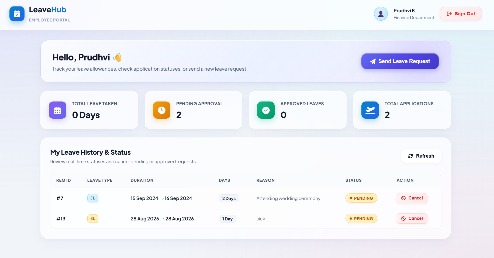

# Employee Leave Management System

A full-stack, enterprise-grade **Employee Leave Management System** built with **Java 17, Spring Boot 3, Spring Data JPA, MySQL, and HTML5/CSS3/JavaScript web interface**.

---

##  Key Highlights

- **Separated Portals & Role-Based Access Control (RBAC)**:
  -  **Admin Portal**: Approve or reject leave applications, register staff accounts, review the directory, and execute real-time SQL tasks.
  -  **Employee Portal**: Dedicated self-service interface to send leave requests, track real-time statuses, and cancel active applications.
- **Strict Business Rule Enforcement**:
  - Employee name cannot be blank.
  - Leave types restricted to `CL` (Casual Leave), `SL` (Sick Leave), and `EL` (Earned Leave).
  - Start date cannot be after end date (`startDate <= endDate`).
  - **Approved leave cannot be rejected**.
  - **Rejected leave cannot be cancelled**.
  - Automatic leave duration calculation (`endDate - startDate + 1`).
- **Clean White / Light Themed UI**:
  - Modern typography (*Plus Jakarta Sans* & *JetBrains Mono*).
  - Instant live leave-day calculator with micro-animations.
  - Toast notification alerts for real-time feedback.
  - 1-Click Demo Login to switch between Admin and Employee personas instantly.
- **All 5 Assignment SQL Tasks Solved & Integrated**:
  - Live query runner viewable directly in the dashboard.
- **100% Passing JUnit 5 & Mockito Test Suite**:
  - Comprehensive unit and integration test coverage.

---

##  Application Architecture

```
                       Browser (HTML5 / CSS3 / Vanilla JS)
                                     │
                    fetch() [JSON REST APIs / CORS Enabled]
                                     ▼
        ┌───────────────────────────────────────────────────────────┐
        │                 Spring Boot Application                   │
        │                                                           │
        │  AuthController   EmployeeController   LeaveController   │
        │        │                   │                  │           │
        │        ▼                   ▼                  ▼           │
        │                   EmployeeService       LeaveService      │
        │                            │                  │           │
        │                            ▼                  ▼           │
        │                   EmployeeRepository   LeaveRepository   │
        │                                    │                      │
        │                             Spring Data JPA               │
        └────────────────────────────────────┼──────────────────────┘
                                             │
                                       MySQL Database
                                (leave_management_db)
```

---

##  Project Structure

```
Employee_management/
├── database/
│   ├── schema.sql              ← DDL with PK, FK, Unique & CHECK constraints
│   ├── queries.sql             ← All 5 required SQL tasks with queries
│   └── data.sql                ← Sample seed dataset for testing
├── src/
│   ├── main/
│   │   ├── java/com/example/leave_management/
│   │   │   ├── LeaveManagementApplication.java  ← Application Entry Point
│   │   │   ├── controller/
│   │   │   │   ├── AuthController.java          ← Sign in & session APIs
│   │   │   │   ├── EmployeeController.java      ← /api/employees
│   │   │   │   └── LeaveController.java         ← /api/leaves
│   │   │   ├── service/
│   │   │   │   ├── EmployeeService.java         ← Employee logic & validation
│   │   │   │   └── LeaveService.java            ← Leave business rules & transitions
│   │   │   ├── repository/
│   │   │   │   ├── EmployeeRepository.java      ← JPA CRUD & email search
│   │   │   │   └── LeaveRequestRepository.java  ← JPA CRUD & status finder
│   │   │   ├── entity/
│   │   │   │   ├── Employee.java                ← @Entity (employees table)
│   │   │   │   ├── LeaveRequest.java            ← @Entity (leave_requests table)
│   │   │   │   ├── LeaveType.java               ← Enum: CL, SL, EL
│   │   │   │   ├── LeaveStatus.java             ← Enum: PENDING, APPROVED, REJECTED, CANCELLED
│   │   │   │   └── Role.java                    ← Enum: ADMIN, EMPLOYEE
│   │   │   ├── dto/
│   │   │   │   ├── LoginRequest.java            ← Auth payload
│   │   │   │   ├── AuthResponse.java            ← Session response
│   │   │   │   ├── EmployeeRequest.java         ← Employee creation payload
│   │   │   │   ├── EmployeeResponse.java        ← Employee output contract
│   │   │   │   ├── LeaveRequest.java            ← Leave creation payload
│   │   │   │   └── LeaveResponse.java           ← Leave output contract
│   │   │   └── exception/
│   │   │       ├── ResourceNotFoundException.java (404)
│   │   │       ├── BadRequestException.java       (400)
│   │   │       └── GlobalExceptionHandler.java    (@RestControllerAdvice)
│   │   └── resources/
│   │       ├── application.properties           ← MySQL connection & JPA config
│   │       └── static/
│   │           ├── index.html                   ← Auth Screen + Admin & Employee Portals
│   │           ├── style.css                    ← Modern White / Light Theme Design System
│   │           └── app.js                       ← Portal controller, validation, fetch APIs
│   └── test/
│       └── java/com/example/leave_management/
│           ├── LeaveManagementApplicationTests.java
│           └── service/
│               ├── EmployeeServiceTest.java     ← JUnit 5 & Mockito test cases
│               └── LeaveServiceTest.java        ← Business rule & transition tests
├── pom.xml                                      ← Maven dependencies & plugins
├── test_cases.md                                ← Manual test case specification document
└── README.md                                    ← Project documentation
```

---

##  Database Design

### `employees` Table
| Column | Type | Constraints | Description |
|---|---|---|---|
| `id` | `BIGINT` | `PRIMARY KEY`, `AUTO_INCREMENT` | Unique employee identifier |
| `name` | `VARCHAR(100)` | `NOT NULL` | Full employee name (cannot be blank) |
| `email` | `VARCHAR(150)` | `NOT NULL`, `UNIQUE` | Unique corporate email |
| `department` | `VARCHAR(100)` | `NOT NULL` | Employee department |
| `role` | `VARCHAR(20)` | `NOT NULL`, `CHECK (role IN ('ADMIN', 'EMPLOYEE'))` | Access level |

### `leave_requests` Table
| Column | Type | Constraints | Description |
|---|---|---|---|
| `id` | `BIGINT` | `PRIMARY KEY`, `AUTO_INCREMENT` | Unique request identifier |
| `employee_id` | `BIGINT` | `NOT NULL`, `FOREIGN KEY (employees.id)` | Associated employee |
| `leave_type` | `VARCHAR(5)` | `NOT NULL`, `CHECK (leave_type IN ('CL', 'SL', 'EL'))` | Type of leave |
| `start_date` | `DATE` | `NOT NULL` | First day of leave |
| `end_date` | `DATE` | `NOT NULL`, `CHECK (end_date >= start_date)` | Last day of leave |
| `leave_days` | `INT` | `NOT NULL` | Auto-calculated duration (`end - start + 1`) |
| `status` | `VARCHAR(20)` | `NOT NULL`, `DEFAULT 'PENDING'` | `PENDING`, `APPROVED`, `REJECTED`, `CANCELLED` |
| `reason` | `TEXT` | `NULL` | Optional employee reason |

---

##  The 5 Required SQL Tasks

All 5 SQL tasks are available in [`database/queries.sql`](database/queries.sql) and executed live inside the **Admin Portal**:

```sql
-- 1. Find employees with more than 5 leave days
SELECT e.id, e.name, e.department, SUM(lr.leave_days) AS total_leave_days
FROM employees e
JOIN leave_requests lr ON lr.employee_id = e.id
GROUP BY e.id, e.name, e.department
HAVING SUM(lr.leave_days) > 5
ORDER BY total_leave_days DESC;

-- 2. Calculate total leave taken by each employee
SELECT e.id, e.name, e.department,
       COALESCE(SUM(lr.leave_days), 0) AS total_leave_days,
       COUNT(lr.id) AS total_requests
FROM employees e
LEFT JOIN leave_requests lr ON lr.employee_id = e.id
GROUP BY e.id, e.name, e.department
ORDER BY total_leave_days DESC;

-- 3. Find pending leave requests
SELECT lr.id, e.name AS employee_name, e.department, lr.leave_type,
       lr.start_date, lr.end_date, lr.leave_days, lr.reason
FROM leave_requests lr
JOIN employees e ON e.id = lr.employee_id
WHERE lr.status = 'PENDING'
ORDER BY lr.start_date;

-- 4. Find employees with NO leave requests
SELECT e.id, e.name, e.email, e.department
FROM employees e
LEFT JOIN leave_requests lr ON lr.employee_id = e.id
WHERE lr.id IS NULL
ORDER BY e.name;

-- 5. Find the most frequently used leave type
SELECT leave_type, COUNT(*) AS usage_count
FROM leave_requests
GROUP BY leave_type
ORDER BY usage_count DESC
LIMIT 1;
```

---

##  API Documentation

### 1. Authentication Endpoints
- `POST /api/auth/login` - Sign in using email address.
- `GET /api/auth/users` - Get available accounts for demo login.

### 2. Employee Endpoints
- `POST /api/employees` - Register a new employee (`201 Created`).
- `GET /api/employees` - List all employees (`200 OK`).
- `GET /api/employees/{id}` - Fetch employee by ID (`200 OK` or `404 Not Found`).

### 3. Leave Request Endpoints
- `POST /api/leaves` - Submit a leave application (`201 Created`).
- `GET /api/leaves` - List all leave requests across company (`200 OK`).
- `GET /api/leaves/employee/{employeeId}` - List leave requests for a specific employee.
- `GET /api/leaves/{id}` - Fetch single leave request by ID.
- `PUT /api/leaves/{id}/approve` - Approve a `PENDING` request (`200 OK`).
- `PUT /api/leaves/{id}/reject` - Reject a `PENDING` request (Blocked if already `APPROVED`).
- `PUT /api/leaves/{id}/cancel` - Cancel a request (Blocked if already `REJECTED`).

---

## 🛠️ Setup & Running Instructions

### 1. Prerequisites
- Java 17 or higher (`java -version`)
- Apache Maven 3.8+ (`mvn -version`)
- MySQL Server 8.0+ running on port `3306`

### 2. Database Configuration
In [`src/main/resources/application.properties`](src/main/resources/application.properties), configure your MySQL credentials:
```properties
spring.datasource.url=jdbc:mysql://localhost:3306/leave_management_db?createDatabaseIfNotExist=true&useSSL=false&serverTimezone=UTC&allowPublicKeyRetrieval=true
spring.datasource.username=root
spring.datasource.password=root
```
*(Hibernate will automatically create the tables on startup via `spring.jpa.hibernate.ddl-auto=update`)*.

To seed initial test data, run:
```bash
mysql -u root -p leave_management_db < database/data.sql
```

### 3. Build & Run Application
```bash
# Compile and package
mvn clean package -DskipTests

# Run Spring Boot server
mvn spring-boot:run
```

The application will start on: **`http://localhost:8080`**

Open `http://localhost:8080` in your web browser.

---

##  Running Automated Tests

Run the full JUnit 5 and Mockito test suite with:
```bash
mvn test
```

**Results**:
- `LeaveManagementApplicationTests`: Spring Context smoke test
- `EmployeeServiceTest`: 5 test scenarios (creation, blank name validation, duplicate email guard, find by ID)
- `LeaveServiceTest`: 7 test scenarios (day calculations, date constraints, invalid leave types, approval, rejection, and cancellation transition rules)
- **13 Tests Passed, 0 Failures, 0 Errors.**

---

## Demo Personas

When launching the web application, you can sign in using one of the pre-configured accounts:

1. ** Administrator (Admin Portal)**:
   - **Email**: `sarah.admin@example.com` | **Password**: `admin123`
   - **Privileges**: Approve/reject leaves, add employees, view SQL analytics.
2. ** Staff Member (Employee Portal)**:
   - **Email**: `alice.johnson@example.com` | **Password**: `password123`
   - **Privileges**: Send leave applications, view personal history, cancel requests.

---

## Screenshots

### Admin Portal


### Employee Portal


---
